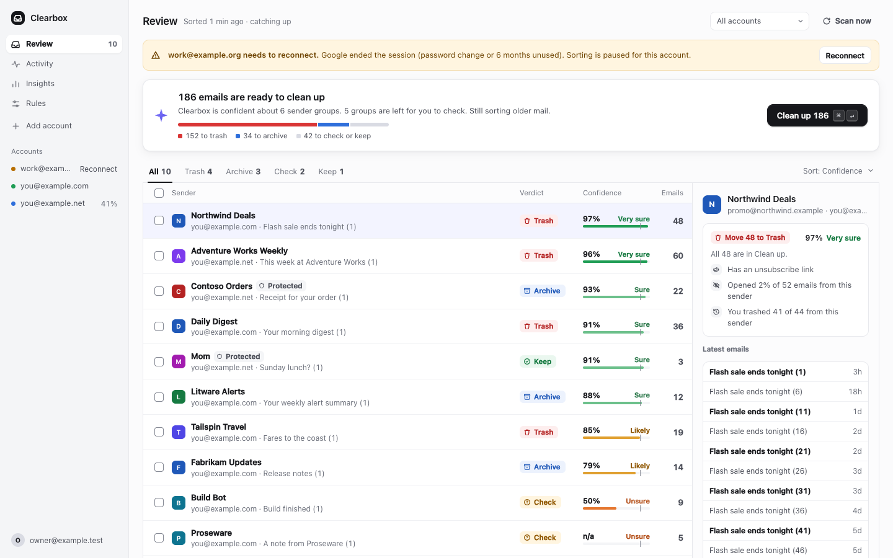
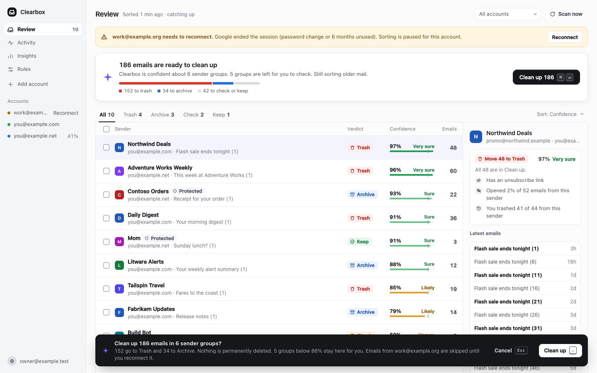
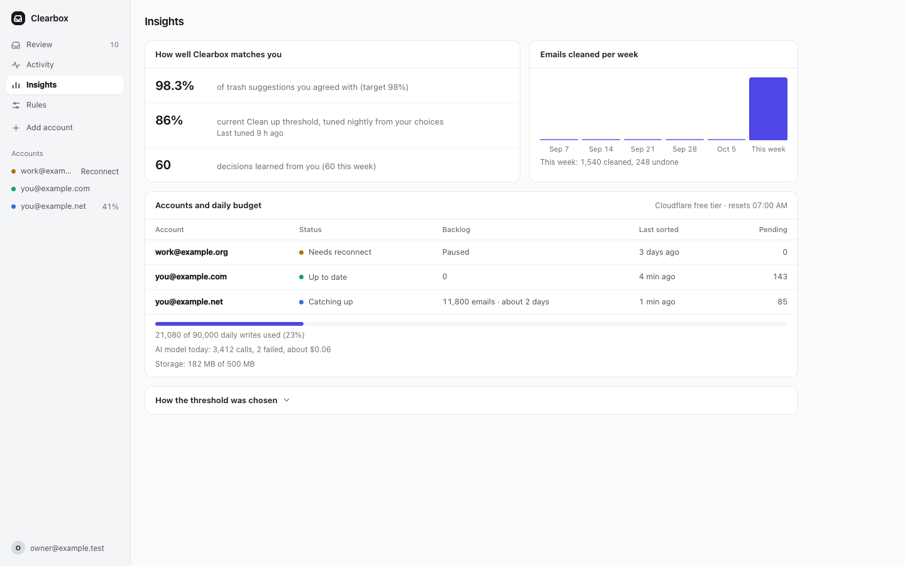
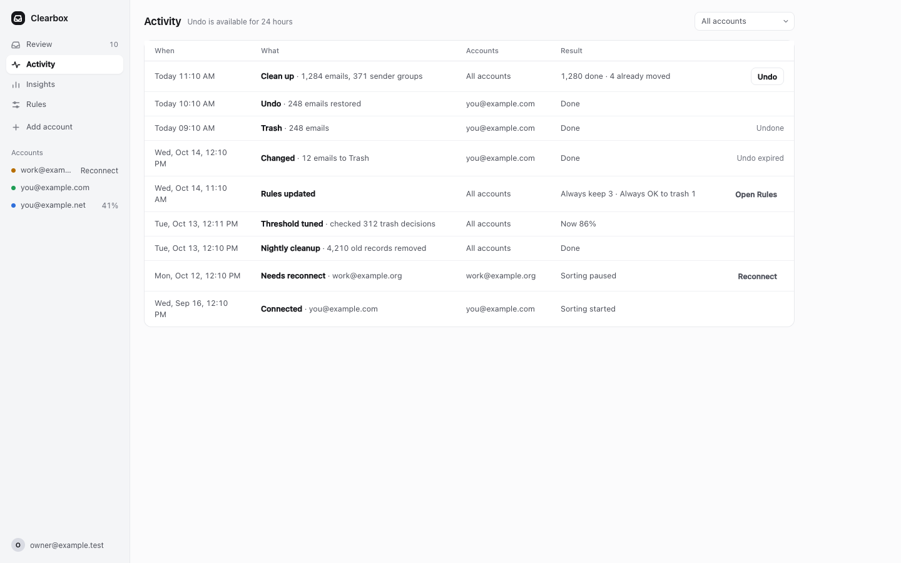
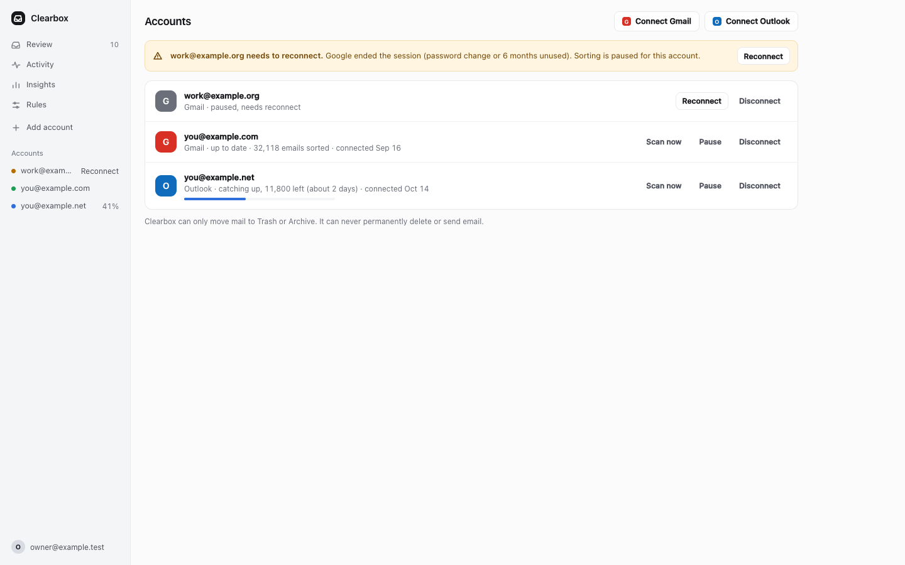
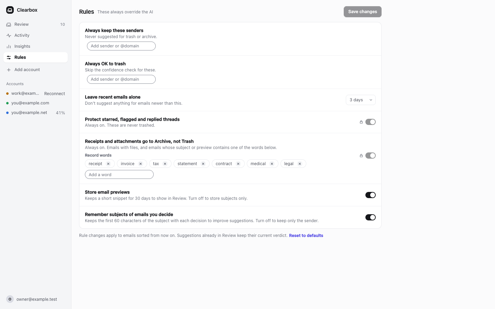
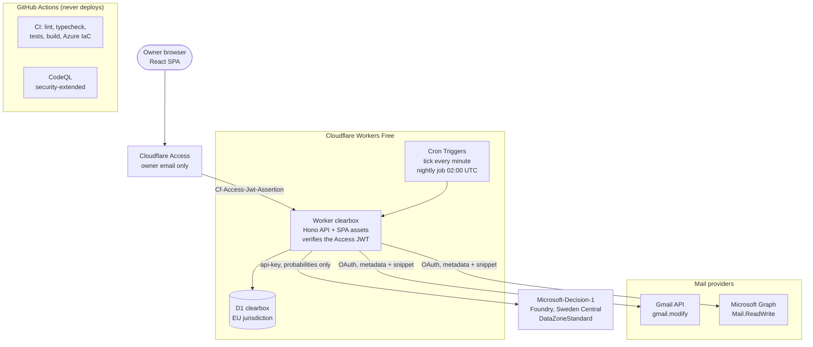

<div align="center">


# Clearbox

**Self-hosted inbox cleanup for Gmail and Outlook. The AI pre-sorts, you confirm in bulk.**

Clearbox sorts every inbox email into trash, archive, keep or unsure before you arrive, explains each suggestion, and moves only what you approve. A weekly 5 to 10 minute Clean up replaces reading email by email.

[](https://github.com/ShinyQ/Clearbox/actions/workflows/ci.yml)
[](https://github.com/ShinyQ/Clearbox/actions/workflows/codeql.yml)
[](LICENSE)
<br>
[](https://www.typescriptlang.org)
[](https://react.dev)
[](https://vite.dev)
[](https://tailwindcss.com)
[](https://hono.dev)
[](https://developers.cloudflare.com/workers/)
[](https://learn.microsoft.com/en-us/azure/foundry/foundry-models/how-to/use-foundry-models-microsoft-decision)
[](https://pnpm.io)
[](https://nodejs.org)

**[Quick start](#quick-start)** · **[Features](#highlights)** · **[Architecture](#architecture)** · **[Docs](#docs)** · **[Security](SECURITY.md)**

<br>


<sub>The Review screen with the synthetic dev seed (<code>app/test/web/fixtures/dev-seed.sql</code>). Captured from <code>pnpm dev</code> in headless Chrome at 1440x900 (2x). Every sender, address and subject is made up.</sub>

</div>

## Contents

[What is this](#what-is-this) · [Highlights](#highlights) · [Screens](#screens) · [Architecture](#architecture) · [Tech stack](#tech-stack) · [Quick start](#quick-start)
· [Project structure](#project-structure) · [Testing and CI](#testing-and-ci) · [Deploy](#deploy) · [Security](#security) · [Docs](#docs)

## What is this

Clearbox is a private inbox assistant you deploy for yourself. The AI prepares, the human confirms: every email is pre-sorted into trash, archive, keep or unsure, grouped by sender, with a calibrated confidence and up to three concrete reasons. You skim the groups, override what looks wrong and run one Clean up. Nothing moves without your approval, and "trash" always means a recoverable move to Trash or Deleted Items, never a permanent delete.

Each deployment serves a single owner. You run your own copy on Cloudflare Workers Free behind Cloudflare Access, with your own Google and Microsoft OAuth clients and your own Microsoft Foundry deployment. This repository contains no shared service and no shared credentials.

<details>
<summary><b>Limitations</b></summary>

- Gmail and Outlook (Microsoft Graph) only; no IMAP.
- Single owner; not a multi-tenant service.
- No permanent deletion and no unsubscribe automation, by design.
- The first backfill of a large inbox takes days on the Free plan (D1 write budget).
- Microsoft-Decision-1 is a Preview model; version 1 retires on 2027-02-04 ([runbook](docs/runbook.md#11-decision-1-outage-or-errors)).
- A personal Google OAuth app shows the "unverified app" warning (you approve your own app once).
- Work or school Microsoft accounts may need admin consent.
- Suggestions use the provider snippet (up to 255 characters), not the full body.
- The `cf` CLI and the Cloudflare Vite plugin 2.0 are in beta; versions are pinned.
- Clearbox uses 2 of the 5 Cron Triggers available per Cloudflare account on Free.

</details>

## Highlights

- **One-click Clean up**: everything above the confidence threshold goes into a single batch; one confirm moves hundreds of emails to Trash or Archive.
- **Confidence bands and reasons**: every sender group shows a calibrated confidence (Very sure, Sure, Likely, Unsure) and up to three reasons built from real signals, such as "You trashed 41 of 44 from this sender".
- **Guardrails**: starred, flagged and replied threads, recent mail and your always-keep senders are never trashed; people you write to, attachments and receipts are capped at keep or archive unless you mark the sender as always OK to trash.
- **Learns from your choices**: every approval or override updates per-sender priors, and a nightly job tunes the trash threshold to the lowest value that keeps delete precision at or above 98%.
- **Gmail and Outlook, multi-account**: connect several mailboxes in one deployment and review them together or one at a time.
- **Undo for 24 hours**: trash and archive moves can be restored from Activity for 24 hours (the providers keep Trash for about 30 days).
- **Keyboard-first**: `J`/`K` to move, `X` to select, `T`/`A`/`E` for trash, archive and keep, `Cmd`/`Ctrl`+`Enter` to Clean up, `G` then a letter to switch pages, `?` for the full list.
- **Runs on Cloudflare Free**: a once-a-minute tick processes one page per mailbox within the Workers and D1 Free limits; Workers Paid only makes it faster.
- **EU data residency**: D1 is created in the EU jurisdiction and Decision-1 runs on DataZoneStandard in Sweden Central.
- **Security model**: Cloudflare Access plus JWT verification in the Worker, least-privilege OAuth, encrypted tokens, plain-text email rendering and a strict CSP. See [Security](#security).

## Screens

|                                                                                              | Screen        | Route        | What is there                                                                                                                                                         |
| -------------------------------------------------------------------------------------------- | ------------- | ------------ | --------------------------------------------------------------------------------------------------------------------------------------------------------------------- |
|                     | **Review**    | `/review`    | The Clean up summary with the trash, archive and check split, sender groups by confidence with verdict tags, and a detail panel with reasons and the latest emails.  |
|   | **Clean up**  | `/review`    | The confirm bar opened with **Clean up** or `Cmd`/`Ctrl`+`Enter`: counts per action, the threshold, skipped accounts. `Enter` confirms, `Esc` cancels.                |
|                 | **Insights**  | `/insights`  | Agreement with your trash decisions against the 98% target, the current threshold and when it was tuned, emails cleaned per week, and the daily Free-tier budget. |
|                 | **Activity**  | `/activity`  | Every Clean up, undo, rule change, threshold tuning and nightly cleanup, with **Undo** on trash and archive batches for 24 hours.                                     |
|                 | **Accounts**  | `/accounts`  | **Connect Gmail**, **Connect Outlook**, backfill progress, and **Scan now**, **Pause**, **Reconnect** and **Disconnect** per mailbox.                                  |
|                       | **Rules**     | `/rules`     | Always-keep and always-OK-to-trash senders, the recent-mail window, the locked guardrails, record words, and switches for storing snippets and subjects.               |

All screenshots use the synthetic dev seed. A first visit with no connected mailbox opens `/setup` instead.

## Architecture



- **A pipeline per email**: **signals** from headers and history (unsubscribe headers, bulk mail, authentication results, open rate, whether you wrote to the sender or replied in the thread), then **guardrails** that set the highest allowed action, then **Microsoft-Decision-1** for trash, archive, keep and unsure probabilities, then your **per-sender priors**, then a deterministic **fusion** that suggests trash only above the calibrated threshold (at least 0.80) with a clear margin.
- **One tick per minute**: each tick leases one mailbox, reads one page of up to 25 messages (metadata and the provider snippet only) and writes everything in one D1 batch. **Scan now** runs the same tick on demand. The nightly job recalibrates the threshold, recovers stale runs and purges old data.
- **Free-tier budgets**: ticks stop at 65,000 D1 rows written per day, the purge at 80,000 and owner actions at 90,000 of the 100,000 limit. That is about 13,000 emails per day during the first backfill and about 6,800 per day sustained. On Workers Paid, `FREE_TIER=false` lifts the gates without code changes.
- **Trash-only**: the mail provider interface has no hard-delete method, and Gmail's `gmail.modify` scope cannot permanently delete anyway.
- **Plain-text email**: subject, sender, date and snippet are rendered as text; HTML bodies never are. The model returns bounded probabilities and no text, so a hostile email cannot make it say or do anything.
- **Encrypted tokens**: refresh and access tokens are encrypted with AES-256-GCM (per-value IV, AAD bound to the account, token kind and key version) with a key held only in Worker secrets.

## Tech stack

| Layer          | Technology                                                                                                  |
| -------------- | ----------------------------------------------------------------------------------------------------------- |
| Language       | TypeScript 6.0 strict (erasable syntax only), Node.js 24                                                    |
| Web UI         | React 19, React Router 8, TanStack Query 5, Tailwind CSS 4                                                  |
| API and jobs   | Hono 4, zod 4, jose 6 (Access JWT), WebCrypto (AES-256-GCM, HMAC)                                           |
| Platform       | Cloudflare Workers Free, Workers Static Assets, D1 (EU jurisdiction), Cron Triggers, Access, Workers secrets |
| Build          | Vite 8, Cloudflare Vite plugin 2.0 beta, `cf` CLI 1.0 beta (pinned)                                         |
| AI             | Microsoft-Decision-1 on Microsoft Foundry (Sweden Central, DataZoneStandard)                                |
| Infrastructure | Bicep and an `az` script in `infra/azure/`                                                                  |
| Testing        | Vitest 5, `@cloudflare/vitest-plugin`, MSW 3, Testing Library, happy-dom, axe-core, `node:test`             |
| Tooling        | pnpm 12.11.2 workspaces, ESLint 10, typescript-eslint, Prettier 3, GitHub Actions, CodeQL, Dependabot       |

## Quick start

Prerequisites: Node.js 24.13 or newer and pnpm 12 (`corepack enable` picks up `packageManager` from `package.json`). No Cloudflare, Azure, Google or Microsoft account is needed to run the UI locally.

```bash
git clone https://github.com/ShinyQ/Clearbox.git
cd Clearbox
pnpm install
```

Create a local `app/.dev.vars` (git-ignored). On `localhost` in development mode the Worker skips Access, so the Access values only need a valid shape; empty Azure and OAuth values turn those features off:

```bash
cat > app/.dev.vars <<EOF
AZURE_DECISION_ENDPOINT=
AZURE_DECISION_KEY=
AZURE_DECISION_DEPLOYMENT=
GOOGLE_CLIENT_ID=
GOOGLE_CLIENT_SECRET=
MS_CLIENT_ID=
MS_CLIENT_SECRET=
TOKEN_ENC_KEY=$(pnpm -s gen-key)
STATE_SIGNING_KEY=$(pnpm -s gen-key)
OWNER_EMAIL=owner@example.test
ACCESS_TEAM_DOMAIN=https://team.example.test
ACCESS_AUD=dev-aud
EOF
```

Create the local D1 database, load the synthetic data shown in the screenshots (optional, once per fresh database) and start the app:

```bash
pnpm db:migrate:local

cd app
CLEARBOX_D1_ID=00000000-0000-4000-8000-000000000000 ./node_modules/.bin/cf d1 raw 00000000-0000-4000-8000-000000000000 \
  --local --persist-to .cloudflare/state --mode development \
  --sql="$(cat test/web/fixtures/dev-seed.sql)"
cd ..

pnpm dev                           # http://localhost:5173
```

The seeded mailboxes carry dummy tokens, so actions that reach a real mailbox (Clean up, Undo, Scan now) fail by design. To connect real mailboxes locally, fill in the OAuth values and register the `http://localhost:5173/oauth/...` redirect URIs ([Cloudflare guide, local development](docs/setup-cloudflare.md#5-local-development)).

### Scripts

| Script                  | What it does                                                                                 |
| ----------------------- | -------------------------------------------------------------------------------------------- |
| `pnpm dev`              | Worker and SPA on `http://localhost:5173` with a local D1 (`cf dev`)                         |
| `pnpm db:migrate:local` | Apply the D1 migrations to the local database in `app/.cloudflare/state`                     |
| `pnpm lint`             | ESLint, then `scripts/check-text.ts` (em dashes, private keys, secret patterns)              |
| `pnpm typecheck`        | Generate Worker types and run `tsc` in every workspace package                               |
| `pnpm test`             | Core, Worker, SPA and eval tests                                                             |
| `pnpm build`            | Production build into `app/.cloudflare/output/` (needs `CLEARBOX_D1_ID`, see Testing and CI) |

<details>
<summary><b>All scripts</b></summary>

| Script                                          | What it does                                                                                          |
| ----------------------------------------------- | ----------------------------------------------------------------------------------------------------- |
| `pnpm format` / `pnpm format:check`             | Prettier write or check over the repository                                                           |
| `pnpm gen-key`                                  | Print a standard base64 key of 32 random bytes (`TOKEN_ENC_KEY`, `STATE_SIGNING_KEY`)                 |
| `pnpm setup:cf`                                 | Guided Cloudflare setup: EU D1, remote migrations, secrets, deploy and Access instructions            |
| `pnpm deploy:cf`                                | Worker types, `tsc` and `cf deploy --no-provision` (after `setup:cf` has stored the D1 id)            |
| `pnpm eval`                                     | Model evaluation against the real Decision-1 deployment (needs the `AZURE_DECISION_*` env vars)       |
| `pnpm --filter @clearbox/eval export-labels`    | Export your own decisions from D1 into the git-ignored `eval/private/`                                |
| `pnpm --filter @clearbox/app test:worker`       | Worker tests only (workerd through `@cloudflare/vitest-plugin`)                                       |
| `pnpm --filter @clearbox/app test:web`          | SPA tests only (happy-dom, Testing Library, axe-core)                                                 |
| `node --test "scripts/test/*.test.ts"`          | Tests for `setup:cf`, `gen-key` and `check-text`                                                      |
| `pnpm exec tsc -p scripts/tsconfig.json`        | Typecheck the scripts                                                                                 |
| `infra/azure/deploy-decision.sh --dry-run ...`  | Print the Decision-1 Bicep deployment without running it ([Azure guide](docs/setup-azure.md))         |

</details>

## Project structure

```text
app/               @clearbox/app: one Vite project for the Worker and the SPA (cloudflare.config.ts)
  src/worker/      Hono routes, scan tick, nightly job, D1 repositories, OAuth, crypto
  src/web/         React SPA: Setup, Review, Activity, Insights, Rules, Accounts
  src/shared/      REST contract shared by the Worker and the SPA
  migrations/      D1 SQL migrations
  test/            Worker and SPA tests, plus the synthetic dev seed
packages/core/     @clearbox/core: pure TypeScript providers, signals, guardrails, decision, fusion, priors, calibration
eval/              @clearbox/eval: evaluation harness and 40 synthetic labeled emails
infra/azure/       Bicep files and the az script for the Decision-1 deployment
scripts/           setup:cf, gen-key and check-text, with node:test tests
docs/              setup guides, runbook, security checklist, UI mockup, design specs, plans, research
.github/           CI, CodeQL and Dependabot
```

## Testing and CI

- **Locally**: `pnpm lint`, `pnpm format:check`, `pnpm typecheck` and `pnpm test`. Production typecheck and build evaluate `app/cloudflare.config.ts`, so run them with `CLEARBOX_D1_ID=00000000-0000-4000-8000-000000000000` (the public local id).
- **CI** ([`ci.yml`](.github/workflows/ci.yml)): one job runs lint (ESLint plus `check-text`), the format check, typecheck for the packages and the scripts, the script tests, all Vitest suites and the production build; a second job runs ShellCheck, a dry run of `deploy-decision.sh` and a Bicep build. CI never deploys and never talks to Cloudflare.
- **CodeQL** ([`codeql.yml`](.github/workflows/codeql.yml)): `security-extended` queries for JavaScript/TypeScript and GitHub Actions on every PR, on `main` and weekly.
- **Dependabot**: weekly grouped updates for npm and GitHub Actions with a 7-day cooldown; actions are pinned by commit SHA.
- **check-text**: fails on em dashes, private key blocks and common secret patterns in every tracked file.

| Suite                  | Runner                                                  | Tests |
| ---------------------- | ------------------------------------------------------- | ----: |
| Core (`packages/core`) | Vitest                                                  |   635 |
| Worker (`app`)         | Vitest in workerd (`@cloudflare/vitest-plugin`), MSW    |   387 |
| SPA (`app`)            | Vitest, happy-dom, Testing Library, axe-core            |   433 |
| Eval harness (`eval`)  | Vitest                                                  |    55 |
| Scripts (`scripts`)    | `node:test`                                             |    49 |

### Model evaluation

`pnpm eval` runs the real pipeline (signals, guardrails, Microsoft-Decision-1, fusion) on 40 synthetic labeled emails in `eval/fixtures/emails.jsonl` and writes a report to the git-ignored `eval/private/reports/`: delete precision and recall, a reliability (calibration) table, an option-order shuffle check, latency p50/p95 and token usage. It needs `AZURE_DECISION_ENDPOINT`, `AZURE_DECISION_KEY` and `AZURE_DECISION_DEPLOYMENT` in the environment and never runs in CI ([Azure guide, section 5](docs/setup-azure.md#5-run-the-model-evaluation)). To evaluate on your own decisions, export them with `pnpm --filter @clearbox/eval export-labels` and run `pnpm eval --fixtures private/owner-labels.jsonl`. Never commit exported labels: they contain your real senders and subjects.

## Deploy

Deploy Microsoft-Decision-1 first with `infra/azure/deploy-decision.sh` (Bicep, Sweden Central, `DataZoneStandard`), then run `pnpm setup:cf` after `./app/node_modules/.bin/cf auth login`: it creates the EU D1 database, applies the migrations, sets the Worker secrets, deploys with `--no-provision` and prints the redirect URIs and the steps to put a Worker-level Cloudflare Access application in front of every hostname. Google and Microsoft OAuth clients can be added at any time. The guides walk through each step: [Cloudflare](docs/setup-cloudflare.md), [Azure](docs/setup-azure.md), [Google](docs/setup-google.md), [Microsoft](docs/setup-microsoft.md), and the [runbook](docs/runbook.md) for key rotation, budgets, restores and rollbacks.

| Item                                                            | Cost                                                                                                      |
| --------------------------------------------------------------- | --------------------------------------------------------------------------------------------------------- |
| Cloudflare Workers, D1, Cron Triggers, Workers Logs (Free plan) | $0                                                                                                        |
| Cloudflare Access (Zero Trust Free, up to 50 users)             | $0                                                                                                        |
| Gmail API, Microsoft Graph                                      | $0                                                                                                        |
| Microsoft-Decision-1, DataZoneStandard                          | $0.042 per 1M input tokens, output free; 450 to 800 tokens per email: **about $0.19 to $0.34 per 10,000 emails** |

A 50,000-email inbox costs roughly $0.95 to $1.70 to sort once.

## Security

- **One owner per deployment**: a Worker-level Cloudflare Access application protects every hostname, and the Worker verifies the Access JWT itself (signature, issuer, audience, expiry, owner email). Missing configuration fails closed.
- **Least-privilege OAuth**: Gmail `gmail.modify` cannot permanently delete; Graph uses delegated `Mail.ReadWrite`. Authorization code with PKCE and an HMAC-signed state cookie.
- **Approval required**: no code path moves a message without a pending suggestion you approved in that request; requests are capped at 100 items and idempotent, and trash and archive moves can be undone for 24 hours.
- **Data minimization and residency**: metadata and the provider snippet only, never full bodies; message rows are purged 30 days after a decision. Logs contain opaque ids and counts only.
- **Hostile content**: plain-text rendering, a strict CSP, `X-Clearbox-CSRF` on mutating calls, no CORS.

Report vulnerabilities privately as described in [SECURITY.md](SECURITY.md). Before a first deploy, work through the [security review checklist](docs/security-review-checklist.md).

## Docs

| Doc                                                                    | What it covers                                                                                   |
| ---------------------------------------------------------------------- | ------------------------------------------------------------------------------------------------ |
| [`docs/setup-cloudflare.md`](docs/setup-cloudflare.md)                 | EU D1, `pnpm setup:cf`, secrets, Cloudflare Access, local development, Workers Paid              |
| [`docs/setup-azure.md`](docs/setup-azure.md)                           | Decision-1 with the script, Bicep or plain `az` commands, and running the model evaluation       |
| [`docs/setup-google.md`](docs/setup-google.md)                         | Gmail API, consent screen, OAuth client, reconnects and disconnects                              |
| [`docs/setup-microsoft.md`](docs/setup-microsoft.md)                   | Entra app registration, permissions, admin consent for work or school accounts                   |
| [`docs/runbook.md`](docs/runbook.md)                                   | Where to look, key rotation, re-authentication, purges, restores, budgets, outages, rollbacks    |
| [`docs/security-review-checklist.md`](docs/security-review-checklist.md) | The security gate to pass before a first deploy                                                |
| [`SECURITY.md`](SECURITY.md)                                           | Vulnerability reporting, threat model summary, repository settings, leaked secrets               |
| [`PRODUCT.md`](PRODUCT.md)                                             | Users, purpose, principles and vocabulary                                                        |
| [Design spec](docs/superpowers/specs/2026-10-15-clearbox-design.md)    | Architecture, decision pipeline, security, data model, Free-tier budget, testing                 |
| [Contracts](docs/superpowers/specs/2026-10-15-clearbox-contracts.md)   | Every exact name, type, table, route, constant and dependency version                            |
| [UI design spec](docs/superpowers/specs/2026-10-15-clearbox-ui-design.md) | Design tokens, layout, components, screens, interaction model and accessibility               |
| [UI mockup](docs/design/clearbox-ui-v4.html)                           | The static design mockup (open it in a browser)                                                  |
| [`docs/superpowers/plans/`](docs/superpowers/plans/)                   | Implementation plans, one per layer                                                              |
| [`docs/superpowers/research/`](docs/superpowers/research/)             | Research notes on Cloudflare, Decision-1 and the mail providers                                  |

---

<div align="center">

**Kurniadi Ahmad Wijaya** · AI and Software Engineer

[Website](https://kurniadi.pages.dev) · [LinkedIn](https://www.linkedin.com/in/kurniadiwijaya) · [GitHub](https://github.com/ShinyQ) · [Hugging Face](https://huggingface.co/ShinyQ)
· [Medium](https://kurniadiahmadwijaya.medium.com/) · [Google Scholar](https://scholar.google.com/citations?user=u8OY1foAAAAJ)

Released under the [MIT License](LICENSE).

</div>
