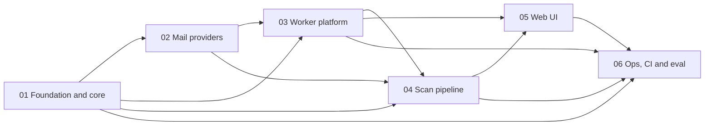

# Clearbox Implementation Plans: Index (plan 00)

> **For agentic workers:** REQUIRED SUB-SKILL: Use superpowers:subagent-driven-development (recommended) or superpowers:executing-plans to implement the six plans below task-by-task, in order 01 to 06. Steps in every plan use checkbox (`- [ ]`) syntax for tracking. Start in an isolated worktree created with superpowers:using-git-worktrees.

**Goal:** Build Clearbox (a self-hosted, single-owner Gmail and Outlook pre-sorter on Cloudflare Workers Free with Microsoft-Decision-1) by executing six reconciled implementation plans in a fixed order, with a verification gate after each plan.

**Architecture:** A pnpm workspace with three packages. `@clearbox/core` (`packages/core`, plans 01 and 02) is pure TypeScript: mail model, Gmail and Graph providers, signals, guardrails, priors, the Decision-1 client and fusion. `@clearbox/app` (`app/`, plans 03 to 05) is one Vite project built by `cf`: a Hono Worker on D1 (Access-protected REST API, OAuth connect, owner actions with undo, a one-account-one-page cron tick and a nightly job) plus the React SPA served as static assets. `@clearbox/eval` and the repository tooling (plan 06) cover setup, infrastructure, CI, docs and offline evaluation.

**Tech Stack:** Node.js 24.13.1, pnpm 12.11.2, TypeScript 6.0.3, zod 4.6.7, Vitest 5.0.4, MSW 3.0.3, Hono 4.13.13, jose 6.2.12, `cf` 1.0.0-beta.17 with `@cloudflare/vite-plugin` 2.0.0-beta.sha-67fa336fd, Vite 8.3.4, `@cloudflare/vitest-plugin` 1.4.2, `@msw/cloudflare` 0.2.0, React 19.3.1, React Router 8.4.0, TanStack Query 5.104.3, Tailwind CSS 4.3.3, happy-dom 21.0.1, Testing Library, axe-core 4.14.0, ESLint 10.12.0, Prettier 3.9.10, Azure Bicep, GitHub Actions.

**Sources of truth:** `docs/superpowers/specs/2026-10-15-clearbox-contracts.md` (rev 2.2; section 12.5 lists what the integration pass changed), `docs/superpowers/specs/2026-10-15-clearbox-design.md` (rev 2), `docs/superpowers/specs/2026-10-15-clearbox-ui-design.md`, `PRODUCT.md`. When a plan and the contracts disagree, contracts rev 2.2 wins; report the difference instead of improvising.

## Global Constraints

- **No em dashes** (U+2014) anywhere: code, comments, tests, UI copy, docs, commit messages. En dashes only in numeric ranges. Enforced by `scripts/check-text.ts` inside `pnpm lint`.
- **Public repository privacy:** no environment-specific values in tracked files (Cloudflare account ids or names, `workers.dev` subdomains, Zero Trust team domains, Azure subscription, resource group or resource names, personal emails, real message content). Use `<your-account-id>`, `<subdomain>.workers.dev`, `<team>.cloudflareaccess.com`, `<foundry-account>`, `<foundry-project>`, `<resource-group>`, `<subscription>`, `<you@example.com>`. Fixtures use only `example.com`, `example.net`, `example.org`, `*.test`, `*.example`; the owner is `owner@example.test`. Secrets never enter the repository; `app/.dev.vars`, `app/clearbox.local.json`, `*.secrets.json` and `eval/private/` are git-ignored.
- **Workers Free budgets:** 10 ms CPU per invocation; one tick = one account and one page (25 messages); at most `TICK_SUBREQUEST_LIMIT = 45` subrequests per tick, D1 calls included; D1 writes 100,000 rows per day with gates `INGEST_STOP_ROWS = 65,000`, `PURGE_STOP_ROWS = 80,000`, `BUDGET_ROWS_PER_DAY = 90,000`; 500 MB per D1 database with backfill paused at `STORAGE_SOFT_LIMIT_BYTES = 450,000,000`; crons `* * * * *` and `0 2 * * *` (5 Cron Triggers per account); Decision-1 concurrency 4.
- **No permanent delete:** `MailProvider` has no hard-delete method; Gmail uses only `gmail.modify`; "delete" is a recoverable move to Trash or Deleted Items; every batch is undoable for 24 hours; nothing executes without an owner approval.
- **Plain-text email:** subjects, snippets, sender names and reasons render as React text nodes only; `dangerouslySetInnerHTML`, `innerHTML` and `insertAdjacentHTML` are banned (ESLint-enforced); the CSP has no inline script or style.
- **Exact versions** from contracts section 2, no ranges; a new dependency requires a contracts section 2 change first.
- **ESM, strict TypeScript, erasable syntax only** (no `enum`, `namespace`, parameter properties, `any`); relative imports with explicit `.ts`/`.tsx`; named exports only.
- **Local typecheck and build** of `app/` run with `CLEARBOX_D1_ID=00000000-0000-4000-8000-000000000000` (the public local id): `cf workers types` and `cf build` evaluate `app/cloudflare.config.ts` in production mode, which refuses to run without a D1 id. Never write that id into `app/clearbox.local.json`.
- **Commits:** stage the files each task names (never `git add -A`: the repository root holds lead-owned untracked files such as `PRODUCT.md` and `docs/design/`). Plan 01's `check-text` scans tracked files, so a task's files must be staged before `pnpm lint`.
- **Logs** carry opaque ids, counts, durations, enum codes and HTTP statuses only.

---

## Execution order

Execute strictly in order. A plan starts only after the previous plan's verification gate passes with every task committed (`git diff --quiet HEAD` succeeds).

Edges are real dependencies: 02 extends 01's provider interfaces and barrel; 03 imports 01 and 02 and owns the token source and provider factory that 04 consumes; 04 replaces 03's tick and nightly stubs and adds the scan-now route; 05 replaces 03's SPA placeholders and calls 03's and 04's routes; 06 replaces 01's `scripts/check-text.ts`, replaces 04's one-section `docs/runbook.md`, documents 03 to 05 and runs the end-to-end gate.

## Plans

| # | File | Scope | Tasks | Produces (for later plans) | Consumes |
|---|---|---|---|---|---|
| 01 | `2026-10-15-clearbox-01-foundation-core.md` | Workspace scaffold (root scripts, ESLint, Prettier, tsconfig, `.gitignore`, `scripts/check-text.ts`) and all of `@clearbox/core` except providers | 18 | root `package.json` scripts (contracts 1.3), `eslint.config.js`, `@clearbox/core` model, constants, errors, HTTP and text utilities, `MailProvider`/`TokenSource`/`TokenUpdate` interfaces, policy, priors, signals, guardrails, Decision-1 client (`MaiDecisionEngine`, `FakeEngine`, `decideAll`), fusion, calibration, `@clearbox/core/testing` | contracts only |
| 02 | `2026-10-15-clearbox-02-mail-providers.md` | Gmail and Graph providers, OAuth helpers, batch codec, provider error classification, MSW fakes | 15 (Task 15 optional, owner-run) | `createGmailProvider`, `createGraphProvider`, `MailProvider.inboxEstimate`, Google and Microsoft authorize/exchange/refresh/revoke/scope helpers, `buildGmailDeepLink`, `FakeMailbox` and handler factories | 01 |
| 03 | `2026-10-15-clearbox-03-worker-platform.md` | `app/` scaffold, D1 migration, Access and CSRF, token crypto, OAuth connect, repositories, every REST route except scan-now, owner actions and undo, SPA placeholders | 16 | `src/shared/api.ts`, `readConfig`, `logEvent` (incl. `request.error`), crypto, `ApiError`, `createApp`, `scan/token-source.ts`, `scan/providers.ts`, `db/*.ts`, test harness (`network`, `apiFetch`, `seed.ts`, `FakeProvider`), stubs of `runTick`/`runNightly`, `accountsRoutes` | 01, 02 |
| 04 | `2026-10-15-clearbox-04-scan-pipeline.md` | Cron tick (claim, fetch, decide, fuse, write, budget), failure path, nightly job and purge, scan-now route, CPU benchmark | 12 | real `runTick`/`runNightly`, `POST /api/accounts/:id/scan`, `scan/{claim,context,ingest,write-plan,failure,tick-tokens,engine}.ts`, `nightly/purge.ts`, `docs/runbook.md` (CPU section) | 01, 02, 03 |
| 05 | `2026-10-15-clearbox-05-web-ui.md` | The SPA: Review with Clean up, Insights, Activity, Accounts, Rules, Setup, errors, offline, gallery, manual QA | 26 | `app/src/web/**`, `app/index.html`, SPA ESLint block, UI labels used by the docs | 01, 03, 04 |
| 06 | `2026-10-15-clearbox-06-ops-ci-eval.md` | `setup:cf`, `gen-key`, extended `check-text`, Azure Bicep, eval package, CI, CodeQL, Dependabot, guides, README, SECURITY, LICENSE, runbook, security checklist, first deploy | 13 | operable deployment, CI gates, eval reports (git-ignored) | 01, 03, 04, 05 |

Total: 100 tasks.

## Verification gate after each plan

Run from the repository root. Every command must exit 0 with the expected output before the next plan starts. If a gate fails, fix forward inside the plan that just finished; do not start the next plan.

- [ ] **Gate 01 (after plan 01)**

Run: `pnpm install --frozen-lockfile && pnpm typecheck && pnpm test && pnpm lint && pnpm format:check && git diff --quiet HEAD && echo committed`
Expected: core `Test Files  27 passed (27)`, `Tests  353 passed (353)` (plan 01 Task 18 Step 6); ESLint silent; `check-text: <N> tracked files clean`; `All matched files use Prettier code style!`; `committed` (no uncommitted changes to tracked files).

- [ ] **Gate 02 (after plan 02)**

Run: `pnpm --filter @clearbox/core typecheck && pnpm --filter @clearbox/core test && pnpm lint && pnpm format:check && git diff --quiet HEAD && echo committed`
Expected: every core test passes (plan 01's plus plan 02's; plan 02 Task 14 Step 6), including `test/providers/exports.test.ts`; lint, `check-text` and Prettier clean; `committed` (no uncommitted changes to tracked files).

- [ ] **Gate 03 (after plan 03)**

Run: `pnpm install --frozen-lockfile && pnpm test && CLEARBOX_D1_ID=00000000-0000-4000-8000-000000000000 pnpm typecheck && pnpm lint && pnpm format:check && CLEARBOX_D1_ID=00000000-0000-4000-8000-000000000000 pnpm build && git diff --quiet HEAD && echo committed`
Expected: core tests pass; the app worker run lists `schema`, `api-schemas`, `config`, `log`, `base64`, `aead`, `hmac`, `pkce`, `access`, `csrf`, `envelope`, `entry`, `sql`, `settings`, `budget-audit`, `repositories`, `db-isolation`, `token-source`, `state-cookie`, `oauth-routes`, `me-accounts`, `queue`, `query-plans`, `execute`, `actions`, `undo`, `activity-insights-policy` with 0 failures and the web run passes `placeholder.test.tsx` (plan 03 Task 16); `app/.cloudflare/output/v0/` exists; `committed` (no uncommitted changes to tracked files).

- [ ] **Gate 04 (after plan 04)**

Run: `pnpm --filter @clearbox/app exec vitest run -c vitest.worker.config.ts test/worker/tick/surface.test.ts test/worker/db-isolation.test.ts && pnpm test && CLEARBOX_D1_ID=00000000-0000-4000-8000-000000000000 pnpm typecheck && pnpm lint && pnpm format:check && git diff --quiet HEAD && echo committed`
Expected: the upstream surface test and the extended isolation test pass; every worker file in `test/worker/tick/`, `test/worker/nightly/` and `test/worker/routes/scan.test.ts` passes alongside plan 03's suites; `tick-cpu.test.ts` reports pure stages under 8 ms median; `docs/runbook.md` exists with the CPU section; `committed` (no uncommitted changes to tracked files).

- [ ] **Gate 05 (after plan 05)**

Run: `pnpm test && CLEARBOX_D1_ID=00000000-0000-4000-8000-000000000000 pnpm typecheck && pnpm lint && pnpm format:check && CLEARBOX_D1_ID=00000000-0000-4000-8000-000000000000 pnpm build`
Expected: core `Test Files  40 passed (40)`, `Tests  635 passed (635)`; app worker `Test Files  49 passed (49)`, `Tests  387 passed (387)`; app web `Test Files  42 passed (42)`, `Tests  422 passed (422)` (every file under `app/test/web`, axe checks included; plan 05 Execution notes explain the counts) and `placeholder.test.tsx` no longer exists; typecheck, ESLint (React hooks rules and the CSP block) and `check-text` clean.

Run: `grep -rl "Components · Clearbox" app/.cloudflare/output/v0 || echo "gallery not shipped"`
Expected: `gallery not shipped`.

Run: `find app/.cloudflare/output/v0 -name index.html -exec grep -cE "<style|style=|<script>" {} \;`
Expected: `0`.

Then confirm every row of plan 05 Task 26 Step 4 (manual visual QA) is ticked.

Run: `git diff --quiet HEAD && echo committed`
Expected: `committed`.

- [ ] **Gate 06 (after plan 06, before any real mailbox is connected)**

Run: `pnpm install --frozen-lockfile && pnpm lint && pnpm format:check && CLEARBOX_D1_ID=00000000-0000-4000-8000-000000000000 pnpm typecheck && pnpm exec tsc -p scripts/tsconfig.json && node --test "scripts/test/*.test.ts" && pnpm test && CLEARBOX_D1_ID=00000000-0000-4000-8000-000000000000 pnpm build`
Expected: every command succeeds; script tests `ℹ tests 43`; eval `Tests  42 passed (42)` (plan 06 Task 13 Step 1). Then plan 06 Task 13 Steps 2 to 6 (Azure deploy and smoke test, live eval, `pnpm setup:cf`, the security checklist, repository settings) complete with their expected output.

## Cross-plan interface registry

Producer wins: a consumer uses exactly these names, paths and signatures. "Tn" is the producing task.

| Symbol or surface | Producer | Consumers |
|---|---|---|
| Root `package.json` scripts (`dev`, `build`, `typecheck`, `lint`, `format`, `format:check`, `test`, `db:migrate:local`, `setup:cf`, `deploy:cf`, `gen-key`, `eval`), `pnpm-workspace.yaml`, `tsconfig.base.json` | 01 T1 | 02 to 06 (no later plan edits the root `package.json`) |
| `eslint.config.js` (`defineConfig`, `"no-console": "error"`) | 01 T1 | 05 T7 (appends the SPA CSP block) |
| `scripts/check-text.ts` (3 rules) | 01 T1 | 06 T1 (replaces with the full rule set and `check-text: allow`) |
| `.gitignore` (contracts 3.9, incl. `.superpowers/`, `.impeccable/`) | 01 T1 | 06 T5 (appends `eval/private/`) |
| Model types, `ACTION_RANK`, `isAllowedByCeiling`, `REASON_TEMPLATES`, `renderReason`, every contracts 4.13 constant | 01 T2 | 02; 03 T6 to T15; 04 T2 to T10; 05 (types only); 06 T5 to T8 |
| `ClearboxError(code, message?, { cause? })`, `ProviderAuthError({ provider, reason })`, `ProviderConfigError`, `ProviderRateLimitError({ provider, retryAfterMs })`, `ProviderUnavailableError`, `CursorExpiredError`, `ProviderResponseError`, `SubrequestBudgetError`, `ScopeMissingError`, `DecisionError({ kind, status?, retryable?, scope?, retryAfterMs?, requestId? })` | 01 T3 | 02; 03 T4, T8, T9, T12; 04 T1, T6, T8; 06 T7 |
| `FetchLike`, `SubrequestCounter`, `createSubrequestCounter`, `countingFetch`, `backoffMs`, `parseRetryAfter`, `fnv1a32`, `seededShuffle`, `mapWithConcurrency` | 01 T4 | 02; 03 T5, T6; 04 T6, T7; 06 T7 |
| `MailProvider`, `ProviderDeps`, `GraphProviderDeps`, `BootstrapResult`, page and action types; `TokenSource`, **`TokenUpdate`** (the only one), `OAuthTokens`; `OAuthClientConfig`, `AuthorizeParams`, `GOOGLE_SCOPES`, `MICROSOFT_SCOPES`, `MICROSOFT_CONSENT_URLS` | 01 T6 | 02; 03 T5, T8, T9, T10, T12; 04 T3, T7 |
| `PolicySchema`, `DEFAULT_POLICY`, `parsePolicy`, `matchesSenderList`; priors helpers; `extractSignals`; `evaluateGuardrails`; `buildDecisionState`; `decisionSeed`, `buildDecisionQuestions`; `MaiDecisionEngine`; `FakeEngine` (`calls`, `overrides`), `decideAll`; `fuse`; `calibrateTauDelete` | 01 T7 to T17 | 03 T2, T12, T15; 04 T2 to T10; 06 T7, T8 |
| `@clearbox/core/testing`: `makeMailMessage`, `makeSignals`, `decisionHandlers`, `makeDecisionResponseBody` (01 T9, T14, T18); `FakeMailbox`, `gmailHandlers`, `graphHandlers` (02 T8, T11, T14) | 01, 02 | 02 tests; 03 T7 (`makeSignals`); 04 T1, T4, T5 (`makeMailMessage`) |
| `MailProvider.inboxEstimate(): Promise<number \| null>` | 02 T3 (Gmail T8, Graph T11) | 03 T8 (`FakeProvider`), 03 T9 (`completeConnect`, best effort at connect); 04 T7 (`fetchInboxEstimate`, at most daily during backfill) |
| `createGmailProvider(deps)`, `createGraphProvider(deps)` | 02 T8, T11 | 03 T5 (`makeProvider`) |
| `buildGoogleAuthorizeUrl`, `exchangeGoogleCode`, `refreshGoogleToken`, `revokeGoogleToken`, `hasGmailScope`, Microsoft equivalents (no revoke) | 02 T4, T5 | 03 T5 (`PROVIDER_OAUTH`); 04 T3 (through `PROVIDER_OAUTH`) |
| `buildGmailDeepLink(email, providerMessageId)` | 02 T6 | 03 T11 (`toSuggestionItem`) |
| `app/package.json` (scripts `dev`, `build`, `typecheck`, `test`, `test:worker`, `test:web`, `db:migrate:local`, `deploy:cf`; every app and SPA dependency incl. `axe-core`, `@testing-library/user-event`), `cloudflare.config.ts`, `vite.config.ts`, `vitest.worker.config.ts`, `vitest.web.config.ts`, `tsconfig.{,worker,web,node}.json`, `migrations/0001_init.sql`, `.dev.vars.example` | 03 T1 | 04; 05 T1 (verifies, no edit); 06 T3, T9, T11 |
| SPA placeholders `index.html`, `src/web/main.tsx`, `src/web/styles.css`, `test/web/setup.ts`, `test/web/placeholder.test.tsx`, `public/favicon.svg` | 03 T1 | 05 T1 (setup), T2 (index, styles), T25 (main, deletes placeholder test); favicon kept |
| `test/worker/setup/network.ts` (`network`, catch-all + Access JWKS) | 03 T1, T5 | 04 T1 (`useNetwork`, `useNetworkOpen`) |
| `src/shared/api.ts` (contracts 7 + A1 to A6, `OAUTH_CALLBACK_ERRORS`) | 03 T2 | 04 T2, T5, T7, T11; 05 T3 to T25 |
| `readConfig(env): { ok: true; config: AppConfig } \| { ok: false; invalid: string[] }`, `AppConfig`, `CRON_TICK`, `CRON_NIGHTLY` | 03 T3 | 04 T3, T7 |
| `logEvent(name, fields)`, `LogEventName` (incl. `request.error`) | 03 T3, T5 | 04 T7, T8, T10 |
| `importEncKey(raw: Uint8Array)`, `encryptToken(key, plaintext, ctx)`, `decryptToken(key, value: EncryptedValue, ctx)`, `EncryptedValue`, `bytesFromBlob`, `base64ToBytes` | 03 T3, T4 | 04 T1, T3, T7 |
| `ApiError(status, code, message, { details?, retryAt? })`, `onApiError` (logs `request.error`) | 03 T5 | 04 T2 (`scanNowError`) |
| `scan/providers.ts`: `ProviderTarget`, `ProviderFactory`, `makeProvider(target, deps)`, `PROVIDER_OAUTH`, `oauthClientConfig` | 03 T5 | 03 T8 to T14; 04 T3, T7 |
| `createApp(overrides)`, `apiFetch(path, init?, opts?)`, `signAccessJwt` | 03 T5 | 04 T11 |
| Stubs `runTick(env, opts)`, `TickOptions`, `runNightly(env, { now })`; `index.ts` cron routing | 03 T5 | 04 T7, T10 (replace the stubs, keep the signatures); 04 T11 (verifies the routing) |
| `db/sql.ts`: `withCount`, `chunk`, `utcDate`, `nextUtcMidnight`, `toIso` | 03 T6 | 04 T2, T4, T5, T7, T10 |
| `test/worker/helpers/seed.ts` (`testEncKey`, `seedAccount`, ...), `test/worker/db-isolation.test.ts` | 03 T7 | 04 T1, T3, T5, T6; 04 T10 (appends the nightly calibration check) |
| `setInboxEstimateStmt(db, id, estimate, now)` | 03 T7 | 03 T9 |
| `scan/token-source.ts`: `createD1TokenSource({ account, encKey, refresh, now })` (`update`, `refreshCount`), `refreshFnFor(oauth, config, provider, fetch, now, redirectUri)`, `tokenUpdateStmt`, `staticTokenSource`, `TokenAccount` | 03 T8 | 03 T9 to T14; 04 T3 (`openTickTokens`) |
| OAuth landing `302 /settings/accounts?connected=<id>` or `?error=<code>&provider=<kind>` | 03 T9 | 05 T16 (`oauth-return.ts`), T21, T25 (`OAuthReturn` forwards to `/accounts` or `/setup`) |
| `accountsRoutes` (mounted at `/api/accounts`, ends with the `// Plan 04 adds` comment) | 03 T10 | 04 T11 |
| REST routes of contracts 7.3 except scan-now | 03 T10 to T15 | 05 T4 (`endpoints.ts`) |
| `scan/tick-tokens.ts`: `openTickTokens`, `tokenAccountOf`, `providerTargetOf`, `TokenColumns`, `encryptTokenUpdate` | 04 T3 | 04 T5 to T8 |
| `POST /api/accounts/:id/scan` returning `TickReport`; errors 404 `not_found`, 409 `account_busy` (`retryAt`), 409 `account_inactive`, 429 `budget_exhausted` (`retryAt`) | 04 T2, T11 | 05 T17 (`use-scan-now.ts`), T21 (Accounts) |
| `messages.signals_json = JSON.stringify(Signals)`; labels written by owner actions | 04 T5; 03 T12 | 06 T9 (`export-labels`) |
| `docs/runbook.md` (CPU section only) | 04 T12 | 06 T12 (replaces with the full runbook, section 15 keeps it) |
| UI labels: Accounts page `/accounts`, "Connect Gmail", "Connect Outlook", "Scan now", "Pause", "Resume", "Disconnect", "Reconnect", "Undo", banners "Google sign-in is misconfigured." / "Microsoft sign-in is misconfigured." | 05 T16, T21 | 06 T3, T11, T12 |

## Items that need live verification

Every item has a coded fallback; none blocks the local gates. Record each finding in the named research doc or plan, sanitized.

| # | Question | Resolved by | Fallback already in the code |
|---|---|---|---|
| 1 | Graph returns `internetMessageHeaders` on list and on delta when selected (personal and work) | plan 02 Task 15 Step 2 | `$batch` header fallback (plan 02 Tasks 11, 12) |
| 2 | `/me/mailFolders/archive` exists for every mailbox; 404 code | plan 02 Task 15 Step 3 | create "Archive" on 404, else `archiveFolderId = null` and archive suggestions kept (plan 02 Task 11, decision 14) |
| 3 | Gmail `untrash` restores `INBOX` | plan 02 Task 15 Step 6 | restore always re-adds `INBOX` with `batchModify` (plan 02 Task 10) |
| 4 | Gmail sends `Retry-After` on 429 | plan 02 Task 15 Step 7 | `backoffMs(1)` when absent (plan 02 Task 4) |
| 5 | Decision-1 429 body and `retry-after` / `retry-after-ms` headers | plan 06 Task 13 Step 3 (live eval; capture the headers of any 429 with the `curl -D -` call in `docs/superpowers/research/decision-1.md` section 10.1 step 6) | `MaiDecisionEngine` reads `retry-after-ms`, then `retry-after`, else `null`; the tick schedules `awaiting_model` retries (plan 01 Task 14, plan 04 Task 8) |
| 6 | `cf deploy --secrets-file` keeps secrets not listed in the file | plan 06 Task 13 Step 4 (C9) | `setup:cf` lists secrets after every deploy and prints missing names (plan 06 Task 3) |
| 7 | First deploy succeeds while `ACCESS_AUD` is missing | plan 06 Task 13 Step 4 (C11) | documented placeholder AUD rejected by every JWT; Worker fails closed with `access_misconfigured` |
| 8 | D1 accepts `CLAIM_SQL` (upsert after `LIMIT`) | plan 04 Task 2 Step 5 | the subquery form given in that step; report so contracts 8.2 is updated |
| 9 | `@cloudflare/vitest-plugin` 1.4.2 with `experimental.newConfig` loads `app/cloudflare.config.ts` | plan 03 Task 1 Steps 12 and 14 | bindings come from `vitest.worker.config.ts` `miniflare.bindings`; if loading fails, stop and report (contracts 3.6) |
| 10 | `@msw/cloudflare` 0.2.0 `setupNetwork(initialHandlers)` | plan 03 Task 1 Step 9 and Task 5 | `beforeEach(() => network.use(jwksHandler(), catchAll))` (plan 03 Task 5) |
| 11 | D1 BLOB result shape (`ArrayBuffer`, `Uint8Array` or `number[]`) | plan 03 Tasks 4 and 7 | `bytesFromBlob` accepts all three |
| 12 | `cf d1 execute ... --local --file` exists in `cf` 1.0.0-beta.17 | plan 05 Task 26 Step 2 | `sqlite3` on the persisted local database file (decision W18); research documents `cf d1 raw --sql` as the verified local ad hoc command |
| 13 | Build output directory of `cf build` | plan 03 Task 1 Step 15 (expects `app/.cloudflare/output/v0/`) | plan 05 Task 25 Step 6 and Gate 05 read the same directory; update both if it differs |
| 14 | `cf workers types` / `cf build` evaluate `cloudflare.config.ts` in production mode | plan 03 Task 1 Step 15 | every local typecheck and build sets `CLEARBOX_D1_ID=00000000-0000-4000-8000-000000000000` |
| 15 | `tsc -b` accepts `composite` with `noEmit` | plan 03 Task 1 Step 15 | contracts 3.5 fallback (three `tsc -p` calls) |
| 16 | Public repository URL for setup-guide links (`DOCS_BASE_URL`) | plan 05 Task 16 (open item O1) | the URL in `lib/links.ts`; change one constant if the repository moves |

## Recommended execution method

1. Create an isolated worktree with superpowers:using-git-worktrees (branch for example `feat/clearbox-v1`).
2. Execute with superpowers:subagent-driven-development: one fresh subagent per task, given the whole task text plus the plan's Global Constraints and "Contract issues and decisions" table; review each task's diff (spec compliance, then code quality) before the next task starts. Do not batch tasks across plans.
3. Run the plan's verification gate above after its last task; only a green gate unlocks the next plan.
4. Plan 02 Task 15 and plan 06 Task 13 Steps 2 to 6 are owner-run (real mailboxes, Azure, Cloudflare). Run them with the owner present, after Gate 06's local commands.
5. Use superpowers:finishing-a-development-branch after Gate 06.

## Self-review

- **Coverage:** every plan is listed with its task count (18 + 15 + 16 + 12 + 26 + 13 = 100), its gate and its cross-plan surfaces; the registry covers every name a later plan imports from an earlier one, as reconciled by the integration pass (contracts 12.5).
- **Placeholder scan:** no "TBD", "TODO" or deferred steps; every gate is an exact command with an expected result.
- **Consistency:** names in the registry match the producing plans' code (for example `createD1TokenSource`, `refreshFnFor`, `makeProvider(target, deps)`, `readConfig` returning `invalid`, `decryptToken(key, value, ctx)`, `accountsRoutes`, core `TokenUpdate`).
